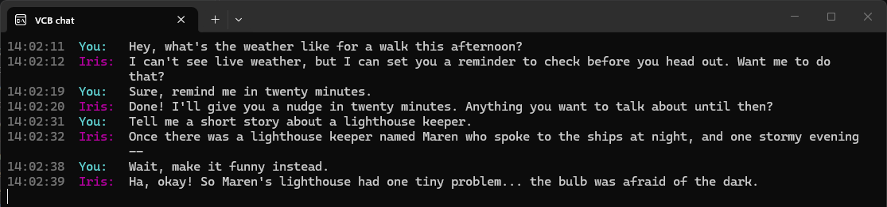
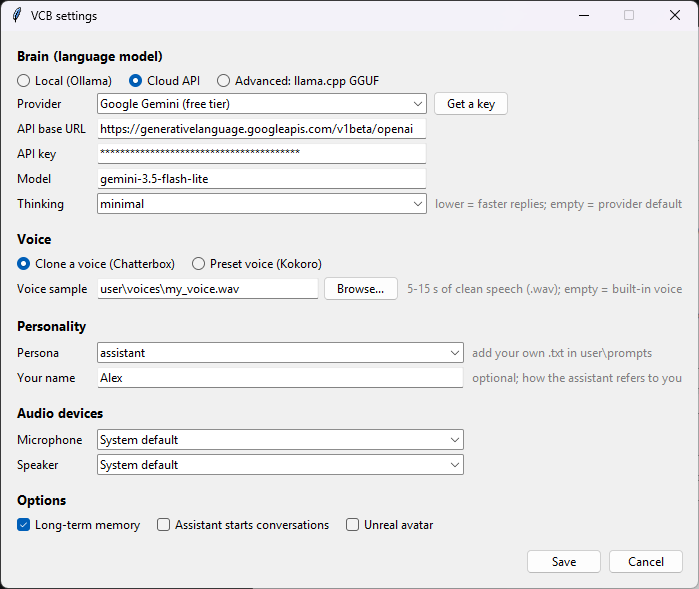
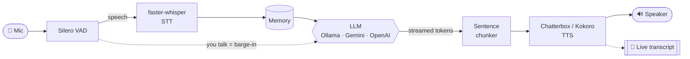

<div align="center">

# 🎙️ VCB — Voice Chat Bot

**Talk to an AI like a phone call. Interrupt it anytime. Runs on your own PC.**

VCB listens continuously, starts answering while it's still thinking, and stops
mid-sentence the moment you talk over it — then picks the thought back up if you
say *"go on"*. One double-click to install, no Python setup required.

[](#-quick-start)
[](https://www.python.org/)
[](#-requirements)
[](#-pick-a-brain)
[](LICENSE)

[Quick start](#-quick-start) •
[Features](#-features) •
[How it works](#%EF%B8%8F-how-it-works) •
[Configuration](#-configuration) •
[FAQ](#-faq--troubleshooting)



<sub>The live chat window — words appear as they're spoken; <code>--</code> marks where you interrupted.</sub>

</div>

---

## ✨ Features

|   |   |
|---|---|
| ⚡ **Real-time streaming** | Speech starts on the first sentence while the LLM is still writing the rest — no waiting for a full reply. |
| ✋ **True barge-in** | Talk over it and it actually stops: the LLM request is cancelled and queued audio is dropped, not just muted. |
| 🔁 **Natural resume** | After an interruption, a quick *"sorry, go on"* makes it continue the cut-off thought; a new question changes topic. |
| 🧬 **Voice cloning** | Give it 5–15 seconds of any voice (yours, with consent) and it speaks in that voice — with natural `<laugh>`s and `<sigh>`s. |
| 🧠 **Any brain** | Local & free with **Ollama**, free-tier **Google Gemini**, **OpenAI**, OpenRouter, Groq, or your own GGUF via llama.cpp. |
| 💾 **Long-term memory** | Remembers facts about you and past conversations across sessions — stored in a local file on your PC. |
| 🛠️ **Tools** | Timers, reminders, calculator, notes, date/time — called by the model mid-conversation. |
| 💬 **Live transcript** | A chat window that writes each word as it's heard, so you can read along. |
| 🎭 **Personas** | 10 built-in personalities (coach, mentor, storyteller, devil's advocate, …) — or write your own in a text file. |
| 🗣️ **AI-led mode** | Optionally the assistant greets you first and keeps the conversation going when you go quiet. |
| 🧍 **3D avatar** *(optional)* | Streams audio, emotions and gestures to an Unreal Engine MetaHuman with Audio2Face lip sync. |

## 🚀 Quick start

> **You need:** Windows 10/11, a microphone, and ~15 GB of free disk space.
> No Python, no command line.

1. **Download** — click the green **Code** button → **Download ZIP**, and extract it.
2. **Run** — double-click **`VCB.bat`**. A settings window opens:

   

3. **Choose a brain** and (optionally) a **voice sample**, then click **Save**.
4. **Wait for the one-time setup** (5–15 min, ~5 GB). VCB installs its own
   private Python and everything it needs into the `.runtime\` folder — nothing
   is installed system-wide.
5. **Start talking.** 🎉

Next time, `VCB.bat` starts in seconds. Change settings anytime with
**`VCB Settings.bat`**.

## 🧠 Pick a brain

| | Option | Cost | Privacy | Setup |
|---|---|---|---|---|
| 🏠 | **Local (Ollama)** | Free | Everything stays on your PC | Install [Ollama](https://ollama.com/download) — VCB downloads the model for you |
| ☁️ | **Google Gemini** | Free tier | Text is sent to Google | Get a key at [aistudio.google.com/api-keys](https://aistudio.google.com/api-keys) |
| ☁️ | **OpenAI / OpenRouter / Groq** | Pay per use | Text is sent to the provider | Paste an API key |
| 🔧 | **llama.cpp** *(advanced)* | Free | Everything stays on your PC | Any `.gguf` model + `llama-server` |

> [!TIP]
> For snappy replies on Gemini use **`gemini-3.5-flash-lite`** with *Thinking* set to
> **`minimal`** (≈0.5 s to the first word). Big "thinking" models can take
> 30+ seconds before they start talking. The settings window's Gemini preset
> picks the fast option for you.

Speech recognition and the voice always run **on your PC** — with a cloud
brain, only *text* is sent to the provider (the conversation, the persona, and
any memories relevant to the current turn), never your audio.

## 🗣️ Voices

- **Clone a voice (Chatterbox)** — pick a 5–15 s `.wav` of clean speech in the
  settings. No file? It uses a pleasant built-in voice.
- **Preset voices (Kokoro)** — light and fast, works even without a GPU.
- **More engines** — XTTS v2, Orpheus and Sesame CSM are available as optional
  extras: `VCB.bat --extras`.

> [!IMPORTANT]
> Only clone voices you have the right to use — your own, or with the speaker's consent.

## 💻 Requirements

| | Minimum | Recommended |
|---|---|---|
| **OS** | Windows 10 / 11 | Windows 11 |
| **GPU** | none (CPU mode: slower, preset voice) | NVIDIA, **8 GB VRAM** with a cloud brain, **16 GB** fully local |
| **Disk** | ~10 GB | ~15 GB (+ your Ollama models) |
| **Internet** | for the first-time download | — fully offline afterwards with Ollama |

## ⚙️ How it works



Every stage is async and streaming: the moment the LLM finishes a sentence it's
synthesized and played while the next one is still being generated. Barge-in
cancels the actual LLM request and drops stale audio using a playback
*generation* counter, so nothing from the old reply leaks out after you
interrupt.

## 🔧 Configuration

Most people only ever use the settings window. Under the hood:

| Where | What |
|---|---|
| **`.env`** | Written by the settings window. Every option is documented in [`.env.example`](.env.example) (GPU pinning, audio devices, feature toggles, …). Git-ignored — safe for API keys. |
| **`user/`** | Your personal stuff, git-ignored: `user/prompts/*.txt` (your personas), `user/voices/` (voice samples), `user/models.json` (llama.cpp presets). |
| **[`vcb/config.py`](vcb/config.py)** | Every other tunable (VAD sensitivity, chunk sizes, memory thresholds, barge-in behavior, …) as typed dataclasses. |

<details>
<summary><b>Launcher & command-line options</b></summary>

| Command | What it does |
|---|---|
| `VCB.bat --settings` | Open the settings window only |
| `VCB.bat --extras` | Also install the optional XTTS / Orpheus / CSM voice engines |
| `VCB.bat --reinstall` | Rebuild the private Python environment from scratch |
| `VCB.bat --ai-led` | The assistant greets you and leads the conversation |
| `VCB.bat --prompt coach` | Use a different persona for this run |
| `VCB.bat --ephemeral` | Memory works during the session but nothing is saved |
| `VCB.bat --no-memory` | Disable long-term memory |
| `VCB.bat --avatar` | Stream to the Unreal avatar app |

Any `main.py` flag can be passed to `VCB.bat`. Run `python main.py --help` for all of them.
</details>

<details>
<summary><b>Write your own persona</b></summary>

Create `user/prompts/myfriend.txt` starting with *"You are &lt;Name&gt;, …"* and
describe the personality and speaking style. Pick it in the settings window
(or `--prompt myfriend`). Use the files in [`prompts/`](prompts) as templates —
they include the rules that keep replies speech-friendly (no markdown, no
narrated actions, emotion tags used sparingly).
</details>

<details>
<summary><b>Unreal Engine MetaHuman avatar</b></summary>

VCB can drive a 3D MetaHuman: it streams the voice audio, emotion tags, and
body-action cues (wave, dance, …) over a local socket to a companion Unreal
Engine plugin, which does Audio2Face lip sync, procedural blinking/gaze, and
gestures. See [`unreal/VcbAvatar`](unreal/VcbAvatar) for setup.
</details>

## ❓ FAQ / Troubleshooting

<details>
<summary><b>The install failed with "Access is denied" / "failed to rename file"</b></summary>

Your antivirus briefly locked a freshly downloaded file. The launcher already
retries automatically; if it still fails, just run `VCB.bat` again — it resumes
where it stopped. If it keeps happening, temporarily pause the antivirus or
exclude the VCB folder.
</details>

<details>
<summary><b>I changed a setting but VCB still uses the old one</b></summary>

If you start VCB from a VS Code terminal, VS Code may have copied the old
`.env` values into that terminal. VCB prints a warning when this happens.
Open a new terminal or just double-click `VCB.bat`.
</details>

<details>
<summary><b>Replies take a long time to start</b></summary>

You're probably using a "thinking" model. In the settings pick a lighter model
(e.g. `gemini-3.5-flash-lite`) and set *Thinking* to `minimal`. With Ollama,
smaller models (4–8B) answer fastest.
</details>

<details>
<summary><b>"My API account is out of credit"</b></summary>

OpenAI's API is prepaid and separate from a ChatGPT subscription. Add credit at
platform.openai.com, or switch to Google Gemini's free tier in the settings.
</details>

<details>
<summary><b>I don't have an NVIDIA GPU</b></summary>

VCB still works: it automatically switches to a smaller speech-recognition
model and the Kokoro preset voice on the CPU. Pair it with a cloud brain for
the best experience. Responses will be slower than with a GPU.
</details>

<details>
<summary><b>Where is my data stored? How do I uninstall?</b></summary>

Everything lives in the VCB folder: settings in `.env`, memory in
`logs\memory.db`, your personas/voices in `user\`. To uninstall, delete the
folder — plus the downloaded models in `%USERPROFILE%\.cache\huggingface`.
</details>

## 🛠️ For developers

<details>
<summary><b>Dev setup, tests, and project layout</b></summary>

The launcher's environment lives in `.runtime\venv` — use it directly
(`.runtime\venv\Scripts\python.exe main.py`), or manage your own with
[uv](https://docs.astral.sh/uv/):

```powershell
uv venv --python 3.12; .venv\Scripts\activate
uv pip install torch==2.7.1 torchaudio==2.7.1 -r requirements.txt `
    -c requirements-lock.txt --override requirements-overrides.txt `
    --extra-index-url https://download.pytorch.org/whl/cu128 --index-strategy unsafe-best-match
python -m pytest
```

The test suite (120+ tests) runs without a GPU, audio device, or LLM server and
covers the parts that are easy to get subtly wrong in a streaming system:
barge-in and stale-audio rejection, retry safety, resume, transcript pacing,
memory, tools, and config resolution.

```
VCB.bat / VCB Settings.bat   double-click launcher / settings
scripts/launch.ps1           launcher logic (uv + private Python + deps)
main.py                      entry point + CLI
vcb/
  orchestrator.py            mic -> VAD -> STT -> LLM -> TTS, barge-in, resume
  state.py                   pipeline phase (idle/listening/thinking/speaking)
  transcript.py              live word-by-word transcript + chat window
  settings.py                tkinter settings window (writes .env)
  config.py                  every tunable, as typed dataclasses
  runtime.py                 Ollama / llama-server lifecycle
  audio/ stt/ llm/ tts/      engines behind small abstract interfaces
  memory/ skills/ avatar/    long-term memory, tool calling, Unreal bridge
prompts/                     example personas
tests/                       pytest suite
unreal/VcbAvatar/            optional Unreal Engine plugin
```

Requirement files: [`requirements.txt`](requirements.txt) (core),
[`requirements-extras.txt`](requirements-extras.txt) (optional engines),
[`requirements-lock.txt`](requirements-lock.txt) (tested versions),
[`requirements-overrides.txt`](requirements-overrides.txt) (resolves
chatterbox-tts's over-strict pins).
</details>

## 🗺️ Roadmap

- [x] Streaming pipeline with true barge-in and resume
- [x] Voice cloning, long-term memory, tools, personas
- [x] One-click Windows launcher and settings window
- [x] Live word-by-word transcript
- [ ] Web search & weather skills
- [ ] Linux / macOS support
- [ ] Webcam-based gaze for the 3D avatar

## 🤝 Contributing

Bug reports and ideas are welcome — please [open an issue](../../issues).
For code changes, open an issue first so we can discuss the approach, and make
sure `python -m pytest` passes.

## 📜 License

VCB is free for personal and other **non-commercial** use under the
[PolyForm Noncommercial License 1.0.0](LICENSE): use it, change it, share it.
Selling it or using it in a commercial product or business requires the
author's permission — [open an issue](../../issues) or contact
[@xulqar9](https://github.com/xulqar9) to ask.

This repository contains only VCB's own code. Libraries and models are not
included: the launcher downloads them from their official sources (PyPI,
Hugging Face) and each keeps its own license — e.g. Chatterbox, Kokoro and
Whisper are MIT/Apache-2.0, Kokoro's English phonemizer is GPL-3.0, the optional
XTTS v2 engine is Coqui's non-commercial CPML, and LLMs follow their provider's
terms.

## 🙏 Acknowledgements

VCB stands on the shoulders of great open-source work:
[Silero VAD](https://github.com/snakers4/silero-vad) ·
[faster-whisper](https://github.com/SYSTRAN/faster-whisper) ·
[Chatterbox](https://github.com/resemble-ai/chatterbox) ·
[Kokoro](https://github.com/hexgrad/kokoro) ·
[Ollama](https://ollama.com) ·
[FastEmbed](https://github.com/qdrant/fastembed) ·
[uv](https://github.com/astral-sh/uv)

<div align="center">
<sub>If VCB is useful to you, consider giving it a ⭐ — it helps others find it.</sub>
</div>
